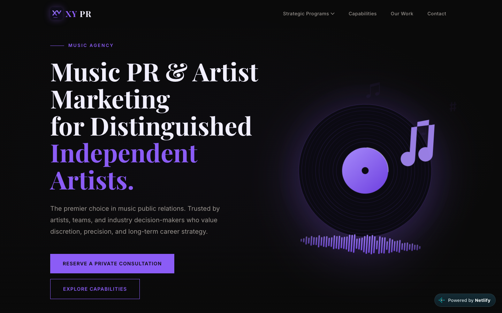

# XY PR

Marketing website for **XY PR**, a music public relations and artist marketing agency for distinguished independent artists.

**Live site:** <https://xy-pr.netlify.app/>

[](https://xy-pr.netlify.app/)

A fully static site: plain HTML, one CSS file, one JS file, and local image assets. No build step, no framework, no dependencies to install.

## Pages

| File | Page |
|---|---|
| `index.html` | Home: hero, trust bar, programs overview, reputation, team, CTA |
| `capabilities.html` | Services accordion (Publicity, Digital Discovery, Branding, Launch Architecture) |
| `our-work.html` | Portfolio grid of campaign case studies |
| `career-programs.html` | Career Acceleration Programs (Ignition, Ascension, Social X) |
| `vanguard-programs.html` | Vanguard Programs (Aladdin, Centurion, Diamond Medallion) |
| `about.html` | About, approach, who we work with |
| `contact.html` | Consultation request form |
| `faq.html` | Frequently asked questions |
| `privacy.html` / `terms.html` | Legal pages |

## Project structure

```
.
├── index.html, *.html      # One file per page; nav and footer are repeated in each
├── css/style.css           # All styles; design tokens live in :root at the top
├── js/main.js              # Nav, mobile menu, accordions, tabs, scroll reveal, form handler
└── images/
    ├── logo.svg, favicon.svg
    ├── screenshot.png      # README preview only, not used by the site
    ├── hero-vinyl.svg, program-*.svg, cover-*.svg, ...   # Generated vector graphics
    └── photos/*.jpg        # Photography (Unsplash, 1600px wide)
```

## Running locally

Any static file server works. For example:

```sh
python3 -m http.server 8080
```

Then open <http://localhost:8080>.

## Customising

**Colours and fonts** are CSS custom properties at the top of `css/style.css`:

```css
--color-gold: #8b5cf6;        /* primary accent (name is historical; currently violet) */
--color-gold-light: #a78bfa;
--color-gold-dark: #6d3fe0;
--color-bg: #0a0a0a;
--font-display: 'Playfair Display', ...;
--font-body: 'Inter', ...;
```

A few `rgba(139, 92, 246, …)` values in gradients and shadows mirror the accent colour; search for them if you change it.

**Photo backgrounds** on heroes, page headers and CTAs are set inline via a `--photo` custom property, e.g.

```html
<header class="page-header page-header--photo" style="--photo: url(images/photos/headphones.jpg)">
```

Swap the path to change the image; the dark overlay is applied by CSS.

**Navigation and footer** are duplicated in every HTML file. If you add a link, update all pages (a quick `sed` across `*.html` is the easiest way).

**Contact form** currently shows a success state client-side only (`js/main.js`). Point it at a real endpoint (Formspree, Netlify Forms, your own API) by adding `action`/`method` to the `<form>` and removing the `preventDefault` handler.

## Deploying

Because the site is static, it can be hosted anywhere: GitHub Pages (serve `main` from the repository root), Netlify, Vercel, Cloudflare Pages, or an S3 bucket.

## Image credits

Photographs are from [Unsplash](https://unsplash.com) and used under the [Unsplash License](https://unsplash.com/license). Vector graphics were generated for this project.
